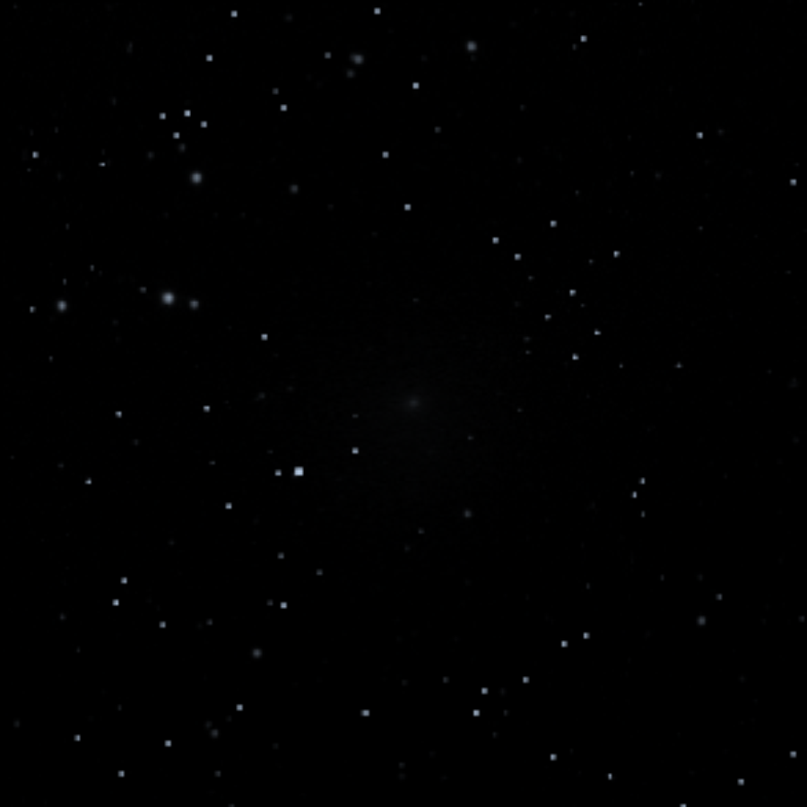

# Watch the Sky — Cipher-X Crew

**NASA Space Apps Challenge 2026 · "NASA SPHEREx and Planet X"**

**Project repository:** https://github.com/sanaasif1217/cipher-x-crew


Watch the Sky makes it easy for anyone to see how a patch of sky changes
over time in real SPHEREx survey images — no astronomy background needed.
Pick one of the challenge's benchmark targets (or the interstellar comet
3I/ATLAS) and play actual NASA archive frames back like a film.

<p align="center">
  
  
</p>
<p align="center"><em>Real SPHEREx level-2 frames served by this project — the 3I/ATLAS comet field (left) and Barnard's Star (right).</em></p>

## Challenge alignment

| Challenge goal | Where it lives in this project | Status |
| --- | --- | --- |
| A public web tool for exploring SPHEREx images | The website in this repo (React + Vite) | Done |
| See how a patch of sky changes over time | "Watch the Sky — Real Frames" viewer: plays 12 real frames per target with play/pause, frame stepping and playback speed | Done |
| The challenge's five named test targets | All five are included as real data packs (table below) | Done |
| A moving-object example | Comet 3I/ATLAS pack — 12 frames from a single morning as it crossed the detector array | Done |
| Enter coordinates and view that patch | Backend API: `GET /api/patch?ra=…&dec=…` generates a frame pack for any coordinates | Done in the backend; generating new packs inside the hosted page is future work |
| Inspectable, honest data | Every frame carries its observation time, detector and wavelength band from the archive manifest | Done |

## What's real here

The **"Watch the Sky — Real Frames"** section of the site is connected to
the project backend in this repository:

- `backend/` — a Python/FastAPI service whose data core queries the
  NASA/IPAC Infrared Science Archive (IRSA) for SPHEREx level-2 images,
  downloads cutouts, registers them on a common grid and renders them as
  web-ready frames.
- `backend/static_data/` — pre-generated data packs: **6 targets × 12 real
  frames**, each with a `manifest.json` giving the observation time,
  detector and wavelength band of every frame.
- The website loads these packs directly (repository path first, then the
  raw GitHub URL), so the real frames play on any hosting — no server
  required. Running the backend is optional and only needed to generate
  packs for *new* coordinates.
- The star cards in "Explore the stars" open the selected star's real
  frames in the viewer.

The 3D starfield journey and the "Sky Time-Lapse & Coordinate Explorer"
are presentation/simulation pieces; the Real Frames viewer is the part
showing genuine archive data, and it is labelled as such on the page.

## How the data packs are made (methodology)

1. **Find epochs.** The backend queries the IRSA TAP service
   (`spherex.obscore`) for level-2 SPHEREx images whose footprint contains
   the target coordinates, and counts every epoch the archive holds.
2. **Download cutouts.** For a 12-frame sample spread across that coverage
   it downloads 0.5° × 0.5° cutouts through the IRSA IBE/DataLink services.
3. **Register.** Each cutout is reprojected onto one common world
   coordinate grid, so the frames line up exactly and only real change
   shows between them.
4. **Prepare for display.** A shared background level is removed and one
   global brightness stretch is applied to the whole series, so frames
   stay comparable — no per-frame cosmetic adjustment.
5. **Publish the pack.** Frames are rendered as 900 × 900 PNGs next to a
   `manifest.json` recording each frame's UTC, observation ID, detector
   and wavelength band, exactly as the archive reports them.

Nothing in a pack is simulated or hand-drawn: if a value appears in the
viewer, it came from the archive or the manifest.

## Targets with real data packs

| Target | Archive epochs | Pack |
| --- | --- | --- |
| 3I/ATLAS (interstellar comet) | 184 | `backend/static_data/3i-atlas` |
| Barnard's Star | 183 | `backend/static_data/barnards-star` |
| Epsilon Indi | 238 | `backend/static_data/epsilon-indi` |
| WISE 0855 | 129 | `backend/static_data/wise-0855` |
| RW Aurigae | 168 | `backend/static_data/rw-aurigae` |
| R Draconis | 1,258 | `backend/static_data/r-draconis` |

## Run the website

```bash
bun install        # the project uses Bun (bun.lock)
bun run dev        # http://localhost:3000
```

With npm instead: `npm install --legacy-peer-deps` then `npm run dev`.

## Run the backend (optional)

```bash
cd backend
pip install -r requirements.txt
uvicorn app:app --host 0.0.0.0 --port 8000
```

- `GET /health` — service status
- `GET /api/star?name=barnards-star` — a target's frame pack
- `GET /api/patch?ra=167.1309&dec=5.1732` — generate a pack for any coordinates
- `python pregenerate.py` — rebuild all static packs from the archive

See `backend/README.md` and `backend/INTEGRATION.md` for details.

## Testing

Pack integrity tests (standard library only) verify that every shipped
pack has a valid manifest, all 12 frames, correct render size, and the
archive epoch totals recorded at generation time:

```bash
python backend/tests/test_packs.py
# Ran 2 tests — OK (all six packs verified)
```

The website build is verified with `npm run build` and `npm run lint`
(TypeScript, no errors).

## Deployment

The site is a static build (`npm run build` → `dist/`) and can be hosted
on GitHub Pages, Vercel or Netlify. The Real Frames viewer fetches its
data packs from this repository, so no backend hosting is required for
the deployed site. A ready-made GitHub Actions workflow for Pages is
kept with the project documentation; enable Pages (Settings → Pages →
GitHub Actions) after adding it under `.github/workflows/`.

## Limitations

- Each pack shows **12 sampled frames**, not the full epoch series —
  chosen so the site stays fast; the archive totals (up to 1,258 epochs)
  are shown with each target.
- New coordinates can be turned into packs by the backend, but not yet
  from inside the hosted web page; that needs the backend running as a
  public service.
- The explorer and 3D journey sections are simulations for presentation;
  only the Real Frames viewer shows archive data, and it says so.
- Frames are single-band level-2 images rendered with a shared stretch;
  they are for watching change, not for photometric measurement.

## Future work

- Generate packs for arbitrary coordinates directly in the web page
  (hosted backend service).
- Difference-imaging view in the Real Frames player (frame-to-frame
  subtraction to highlight movers).
- Longer frame series per target and a field-of-view choice.
- A searchable index over all packs ("fingerprint memory").

## Data sources

- NASA/IPAC Infrared Science Archive (IRSA) — SPHEREx level-2 images and
  observation metadata (archive queries via TAP and the IBE cutout
  service)
- NASA SPHEREx mission (JPL / Caltech)

## Team — Cipher-X Crew

Six members, two countries — Pakistan and India.

| Member | Role |
| --- | --- |
| **Sana Asif** | **Team Leader** — project direction, real-data backend and data packs, repository |
| Sujal Khanolkar | Website design and frontend experience |
| Sherdil Khan | Team Member |
| Naheed Nawaz | Team Member |
| Abdul Qadoos | Team Member |
| Abdullah | Team Member |

**AI assistance:** parts of this project's code and documentation were
developed with AI assistance (Claude, Anthropic) and were reviewed,
tested and directed by the team.

## License

MIT — see `LICENSE`. SPHEREx data courtesy of NASA/IPAC IRSA.

Built for the NASA Space Apps Challenge 2026.
