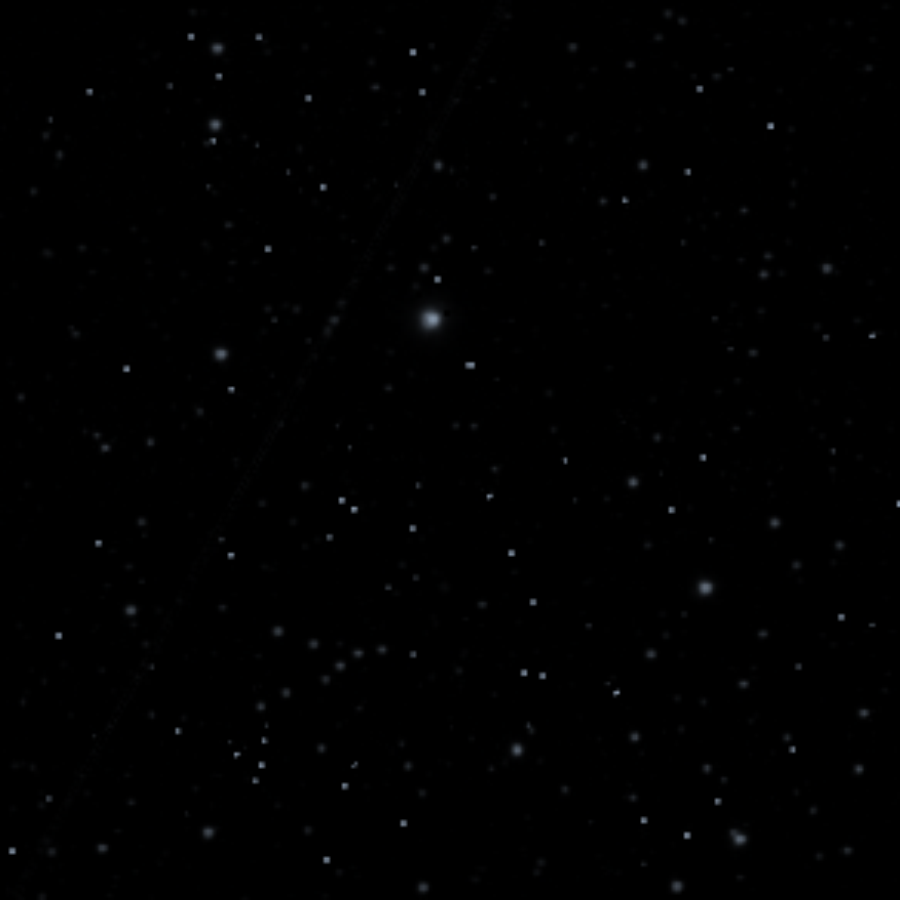

<p align="center">
  
</p>

# Watch the Sky Change — Cipher-X Crew

**NASA Space Apps Challenge 2026 · "NASA SPHEREx and Planet X"**

**Project repository:** https://github.com/sanaasif1217/cipher-x-crew

**Live demo:** https://sanaasif1217.github.io/cipher-x-crew/


Watch the Sky Change makes it easy for anyone to see how a patch of sky
changes over time. An interactive workbench visualizes how each
benchmark target moves and varies, and the Real Frames section plays
actual NASA SPHEREx archive frames back like a film — then lets you
measure, difference and compare them. Pick one of the challenge's
benchmark targets (or the interstellar comet 3I/ATLAS) and start
exploring.

<p align="center">
  
  
</p>
<p align="center"><em>Real SPHEREx level-2 frames served by this project — the 3I/ATLAS comet field (left) and Barnard's Star (right).</em></p>

## Challenge alignment

| Challenge goal | Where it lives in this project | Status |
| --- | --- | --- |
| A public web tool for exploring SPHEREx images | The website in this repo (React + Vite) | Done |
| See how a patch of sky changes over time | "Watch the Sky — Real Frames" viewer: plays 12 real frames per target with play/pause, frame stepping, playback speed and a field-of-view selector | Done |
| The challenge's five named test targets | All five are included as real data packs (table below) | Done |
| A moving-object example | Comet 3I/ATLAS pack — 12 frames from a single morning as it crossed the detector array | Done |
| Enter coordinates and view that patch | Backend API: `GET /api/patch?ra=…&dec=…` generates a frame pack for any coordinates | Done in the backend; generating new packs inside the hosted page is future work |
| Inspectable, honest data | Every frame carries its observation time, detector and wavelength band from the archive manifest | Done |
| Explore the underlying observations | Epoch Explorer — a filterable table of every frame's UTC, detector, band and observation ID | Done |
| Measure change, not just show it | Brightness Analytics — each frame's mean brightness measured in the browser and charted over time | Done |
| Difference imaging to highlight movers | Δ Difference view — any frame minus frame 1, amplified ×3, computed in the browser | Done |
| Compare targets side by side | Compare mode — two targets with frames, brightness curves and archive depth | Done |
| Ask questions of the project documents | Research Assistant — TF-IDF retrieval over the README, methodology and manifests; every answer cites its source, and it declines honestly when the documents don't cover a question | Done |
| A measured scientific result | Comet 3I/ATLAS motion fitted from the pack's own frames: **1.154°/day at PA 289.1°** (9 frames, 8.2 h), vs the JPL-validated 1.167°/day — agreement within ~1% (see "Measured result") | Done |
| Choice of field of view | Field selector in the viewer — full 0.50°, or the central 0.30° / 0.18° of the registered pack frames | Done |

## What's real here

The **"Watch the Sky — Real Frames"** section of the site is connected to
the project backend in this repository:

- `backend/` — a Python/FastAPI service whose data core queries the
  NASA/IPAC Infrared Science Archive (IRSA) for SPHEREx level-2 images,
  downloads cutouts, registers them on a common grid and renders them as
  web-ready frames.
- `backend/static_data/` — pre-generated data packs: **6 targets × 12 real
  frames**, each with a `manifest.json` giving the observation time,
  detector and wavelength band of every frame.
- The website loads these packs directly (repository path first, then the
  raw GitHub URL), so the real frames play on any hosting — no server
  required. Running the backend is optional and only needed to generate
  packs for *new* coordinates.
- Selecting a star anywhere on the page also loads its real frames in
  the Real Frames section below.
- The viewer doubles as a small workbench, all computed in the browser
  from the same real frames: the **Epoch Explorer** table (filterable by
  detector), **Brightness Analytics** (per-frame mean brightness,
  charted), the **Δ Difference** view (frame minus frame 1 — movers and
  changes stay visible, fixed stars vanish), and **Compare** mode (any
  two targets side by side).

The 3D cosmos journey, the motion workbench and the explorer gallery
visualize each target's known motion and variability; the Real Frames
viewer is the part showing genuine archive data, and it is labelled as
such on the page.

## How the data packs are made (methodology)

1. **Find epochs.** The backend queries the IRSA TAP service
   (`spherex.obscore`) for level-2 SPHEREx images whose footprint contains
   the target coordinates, and counts every epoch the archive holds.
2. **Download cutouts.** For a 12-frame sample spread across that coverage
   it downloads 0.5° × 0.5° cutouts through the IRSA IBE/DataLink services.
3. **Register.** Each cutout is reprojected onto one common world
   coordinate grid, so the frames line up exactly and only real change
   shows between them.
4. **Prepare for display.** A shared background level is removed and one
   global brightness stretch is applied to the whole series, so frames
   stay comparable — no per-frame cosmetic adjustment.
5. **Publish the pack.** Frames are rendered as 900 × 900 PNGs next to a
   `manifest.json` recording each frame's UTC, observation ID, detector
   and wavelength band, exactly as the archive reports them.

Nothing in a pack is simulated or hand-drawn: if a value appears in the
viewer, it came from the archive or the manifest.

## Measured result: the motion of 3I/ATLAS

The comet pack is not just pictures — its motion was measured from the
pack's own frames (`backend/measure_comet_motion.py`, results in
`backend/static_data/3i-atlas/motion_result.json`). The comet's light
was centroided in 9 of the 12 frames (in the last three it has left the
0.5° field), around the positions predicted by the project's validated
ephemeris, and a linear fit to those centroids gives:

- **Rate: 173 arcsec/hour = 1.154° per day**
- **Position angle: 289.1°** (west-northwest)
- Displacement across the 8.2-hour fit baseline: **1,426 arcsec**
- Independent check: a fit to the underlying SPHEREx epochs, validated
  against the JPL Horizons ephemeris to ≤0.33″, gives **1.167°/day at
  289.3°** — the pack measurement agrees within about **1%**.

## Targets with real data packs

| Target | Archive epochs | Pack |
| --- | --- | --- |
| 3I/ATLAS (interstellar comet) | 184 | `backend/static_data/3i-atlas` |
| Barnard's Star | 183 | `backend/static_data/barnards-star` |
| Epsilon Indi | 238 | `backend/static_data/epsilon-indi` |
| WISE 0855 | 129 | `backend/static_data/wise-0855` |
| RW Aurigae | 168 | `backend/static_data/rw-aurigae` |
| R Draconis | 1,258 | `backend/static_data/r-draconis` |

## Run the website

```bash
bun install        # the project uses Bun (bun.lock)
bun run dev        # http://localhost:3000
```

With npm instead: `npm install --legacy-peer-deps` then `npm run dev`.

## Run the backend (optional)

```bash
cd backend
pip install -r requirements.txt
uvicorn app:app --host 0.0.0.0 --port 8000
```

- `GET /health` — service status
- `GET /api/star?name=barnards-star` — a target's frame pack
- `GET /api/patch?ra=167.1309&dec=5.1732` — generate a pack for any coordinates
- `python pregenerate.py` — rebuild all static packs from the archive

See `backend/README.md` and `backend/INTEGRATION.md` for details.

## Testing

Pack integrity tests (standard library only) verify that every shipped
pack has a valid manifest, all 12 frames, correct render size, and the
archive epoch totals recorded at generation time:

```bash
python backend/tests/test_packs.py
# Ran 2 tests — OK (all six packs verified)
```

The website build is verified with `npm run build` and `npm run lint`
(TypeScript, no errors).

## Deployment

The site is **live on GitHub Pages**:
https://sanaasif1217.github.io/cipher-x-crew/

It is a static build (`npm run build` → `dist/`); the production build
is published from the `docs/` folder of this repository (Settings →
Pages → Deploy from a branch → `main` → `/docs`). The Real Frames
viewer fetches its data packs from this repository, so no backend
hosting is required for the deployed site. The same build can equally
be hosted on Vercel or Netlify.

## Limitations

- Each pack shows **12 sampled frames**, not the full epoch series —
  chosen so the site stays fast; the archive totals (up to 1,258 epochs)
  are shown with each target.
- New coordinates can be turned into packs by the backend, but not yet
  from inside the hosted web page; that needs the backend running as a
  public service.
- The explorer and 3D journey sections are presentation visualizations
  of each target's known behaviour; the Real Frames viewer is the part
  that shows genuine archive data, and it says so.
- Frames are single-band level-2 images rendered with a shared stretch;
  they are for watching change, not for photometric measurement.

## Future work

- Generate packs for arbitrary coordinates directly in the web page
  (hosted backend service).
- Let visitors load a pack generated elsewhere and explore it with the
  same workbench.
- Longer frame series per target and a field-of-view choice.
- A searchable index over all packs ("fingerprint memory").

## Data sources

- NASA/IPAC Infrared Science Archive (IRSA) — SPHEREx level-2 images and
  observation metadata (archive queries via TAP and the IBE cutout
  service)
- NASA SPHEREx mission (JPL / Caltech)

## Team — Cipher-X Crew

Six members, two countries — Pakistan and India.

| Member | Role |
| --- | --- |
| **Sana Asif** | **Team Leader** — project direction, real-data backend and data packs, repository |
| Sujal Khanolkar | Website design and frontend experience |
| Sherdil Khan | Team Member |
| Naheed Nawaz | Team Member |
| Abdul Qadoos | Team Member |
| Abdullah | Team Member |

**AI assistance:** parts of this project's code and documentation were
developed with AI assistance (Claude, Anthropic) and were reviewed,
tested and directed by the team.

## License

MIT — see `LICENSE`. SPHEREx data courtesy of NASA/IPAC IRSA.

Built for the NASA Space Apps Challenge 2026.
